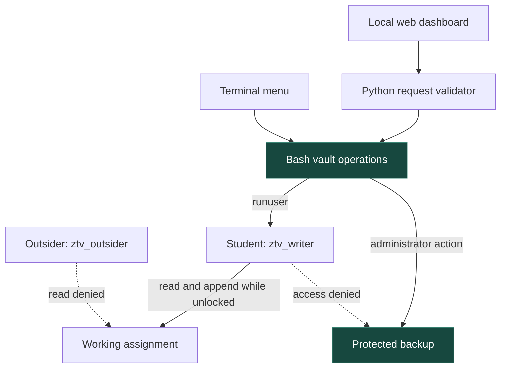
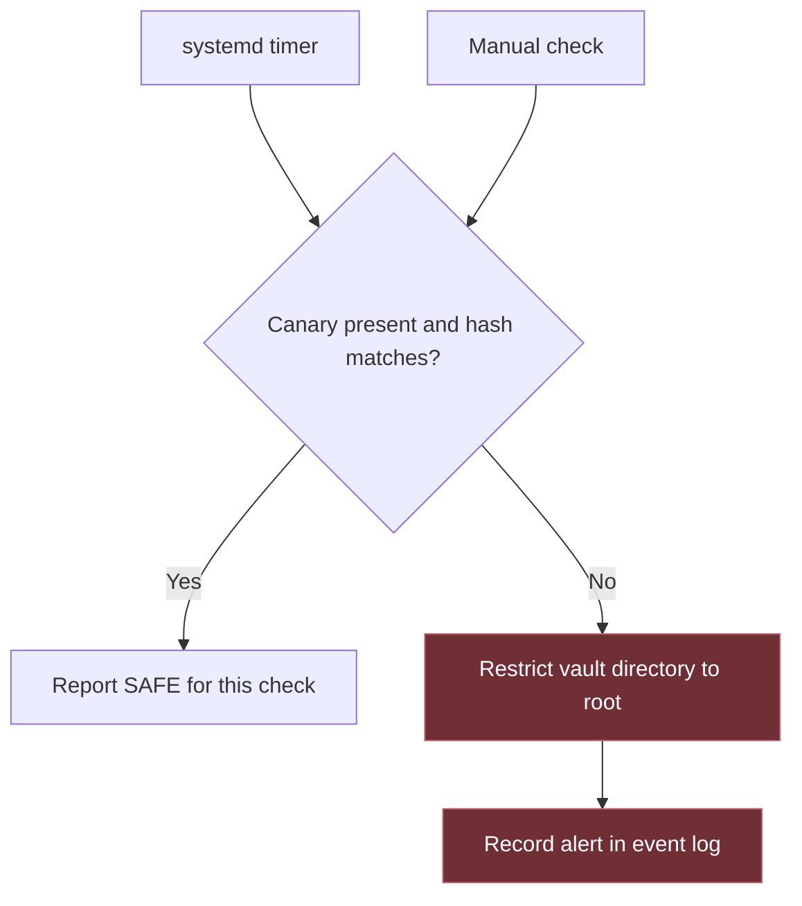
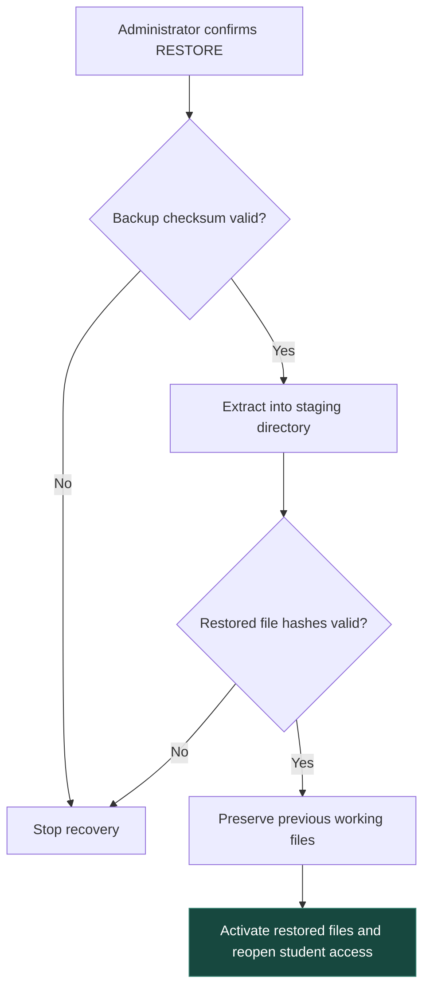
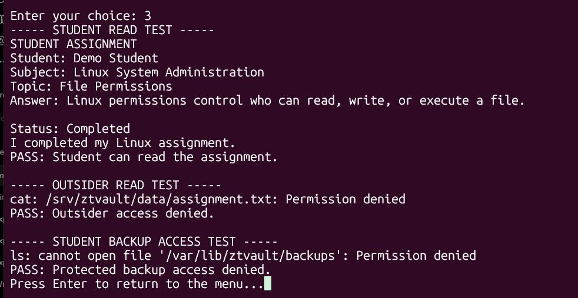
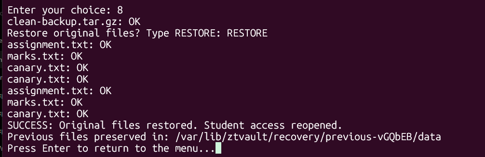

<!-- vault-design-v1 -->
<div align="center">

  

# Zero-Trust Vault

**01 · Control access　 /　 02 · Detect changes　 /　 03 · Restore clean files**

</div>

**Zero-Trust Enterprise Storage Vault with Automated Ransomware Defense and Disaster Rollback**  
Linux System Administration · E1ITA307 · Alliance University, Bengaluru

**[Project report (PDF)](submission/Project_Report.pdf) · [Presentation (PowerPoint)](submission/Project_Presentation.pptx) · [Demo screenshots](submission/screenshots/) · [Bash source](src/ztvault.sh)**

A student should be able to edit an assignment without gaining access to the recovery copy. This Ubuntu project demonstrates that boundary using real Linux accounts. It also monitors a **canary**: a sample file that normal assignment work should leave untouched. If the canary changes or disappears, the vault restricts student access and records an alert. An administrator can then restore the verified backup.

[Quick start](#run-the-project) · [Faculty demo](#five-minute-demonstration) · [System design](#system-design) · [Evidence](#recorded-evidence) · [Team](#team)

## Run the project

Use **Ubuntu with Bash, Python 3, systemd running as PID 1, and administrator access**. The recorded lab used Ubuntu on WSL2 with ext4. The web interface uses Python's standard library and local frontend files; there is no npm or pip install step.

**From Ubuntu:** Open a terminal in the project directory that contains `run.sh` and run:

```bash
sudo bash run.sh
```

**From Windows PowerShell with WSL:** If you extracted the ZIP into Downloads and your default WSL distribution is the project Ubuntu installation, use:

```powershell
Set-Location "$HOME\Downloads\ZeroTrustVault"
wsl -u root -- bash ./run.sh
```

Open **http://localhost:8765** in your browser. Keep the terminal open; press **Ctrl+C** to stop the dashboard. On a fresh lab system, the launcher calls [setup.sh](src/setup.sh) to create the demo accounts and files. It reuses an existing vault. To demonstrate the original Bash menu after installation, run `sudo ztvault` in Ubuntu.

## Five-minute demonstration

| Step | What to do | What to look for |
|---|---|---|
| 1 | Open **Overview**. In **Defense & recovery**, select **Backup / verify** before editing. | A new clean backup is created, or the existing one is verified and preserved. “Present” alone does not confirm integrity. |
| 2 | Select **Test access**. | The student reads the assignment. The outsider cannot read it, and the student cannot list the backup directory. The expected denials are successful tests. |
| 3 | In **Student workspace**, save a sentence such as “I completed my Linux assignment.” Then select **Check now** under Defense & recovery. | The saved sentence appears with the file's modification time in IST. The canary still reports SAFE. |
| 4 | Select **Enable monitor**, then **Simulate incident** and enter `DEMO`. | Only the sample canary changes. Return to Overview and allow about 15 seconds for monitoring and the dashboard refresh. |
| 5 | Select **Test blocking** and open **Activity & logs**. | Once the vault is LOCKED, the student's write attempt fails. The event history records the canary change and alert. |
| 6 | Select **Recover files**, enter `RESTORE`, and reopen the workspace. | The archive and recovered files are checked before student access reopens. The active assignment returns to its backup contents; the previous working files are preserved. |

**Error handling to demonstrate:** Submit an empty sentence or enter the wrong confirmation word. The operation should not proceed. In the terminal menu, enter `99` to show invalid-choice handling.

## System design

### 01 · Who can reach the files?

The browser is an administrator's local control panel. Choosing a student action makes the engine run the file operation as the student account. Linux checks that account's permissions.



### 02 · What triggers containment?

An assignment edit is expected. A canary edit is the incident signal. The timer runs the same integrity check that the administrator can request manually.



### 03 · How does rollback work?



## How the application works

The [web interface](web/) sends a named action to the [local HTTP adapter](server.py). The adapter validates the request and invokes an allowed operation in the [Bash engine](src/ztvault.sh). The Bash engine performs the file, permission, backup and recovery operations. The systemd timer can check the canary while the browser is closed, as long as Ubuntu is running and the timer is active.

| Linux feature | How the project uses it |
|---|---|
| Accounts and permissions | `runuser` exercises the permissions of `ztv_writer` and `ztv_outsider`. The working directory normally uses mode `2770`: root and the vault group have access, and new entries inherit the group. During containment, `chmod 0700` restricts directory access to root. |
| File updates and time | `tee -a` appends the student's sentence. The interface reads the file back and displays its filesystem modification time in IST. New web events record UTC; legacy log entries without a timezone keep their original timestamp. |
| Integrity and storage | `sha256sum` compares file contents with trusted fingerprints. `tar` creates and extracts the clean archive. Fingerprints detect changes; they do not encrypt files. |
| Automation and recovery | `systemctl` manages the monitoring timer. `flock` coordinates competing vault operations. Recovery verifies files in a staging directory before replacing the active originals. |

## Verify the demonstration on Ubuntu

Run these in a **second Ubuntu terminal** while the dashboard is open:

```bash
# Compare with “Last modified” after saving a sentence.
sudo env TZ=Asia/Kolkata stat -c 'Assignment modified: %y' /srv/ztvault/data/assignment.txt

# After enabling monitoring, check the timer and its recent service output.
systemctl status ztvault-monitor.timer --no-pager
sudo journalctl -u ztvault-monitor.service -n 20 --no-pager

# Read the application's own events.
sudo tail -n 10 /var/log/ztvault/events.log
```

The [access test](submission/screenshots/d5-access-tests.png), [incident log](submission/screenshots/d11-security-event-log.png), and [verified recovery](submission/screenshots/d12-verified-recovery.png) are evidence from the recorded **terminal demonstration**. The presentation also explains the web interface. Four portable checks passed on the compact package, covering file updates, timestamps, log parsing and request validation. Real account permissions and timer scheduling depend on the target Ubuntu installation.

## Recorded evidence

| Before containment · access policy | After containment · verified recovery |
|:---:|:---:|
|  |  |

[See automatic containment](submission/screenshots/d10a-automatic-detection-and-containment.png) · [Inspect the event log](submission/screenshots/d11-security-event-log.png) · [Browse all screenshots](submission/screenshots/)

## Scope

This is a local teaching prototype. A change that leaves the canary untouched can go undetected. Directory permissions block new student access through the vault path; they cannot stop root or revoke an already-open file handle. The single clean backup is stored on the same machine, so it does not protect against loss of the disk. **Detection and containment are automatic when monitoring is enabled; recovery requires administrator confirmation.**

## Team

| Member | Registration number |
|---|---|
| Dharshini K | 2411021060912 |
| Kani V | 2411021061023 |
| Hemanath K | 2411021060862 |
| Ibadul Azam | 2411021060840 |

**Supervisor:** Prof. Kusuma J · Alliance School of Advanced Computing, Alliance University

---

**Zero-Trust Vault** · Linux System Administration · [Back to system design ↑](#system-design)
