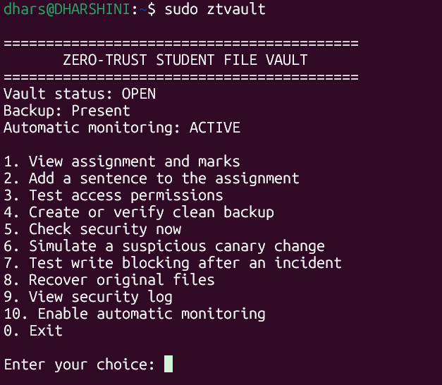
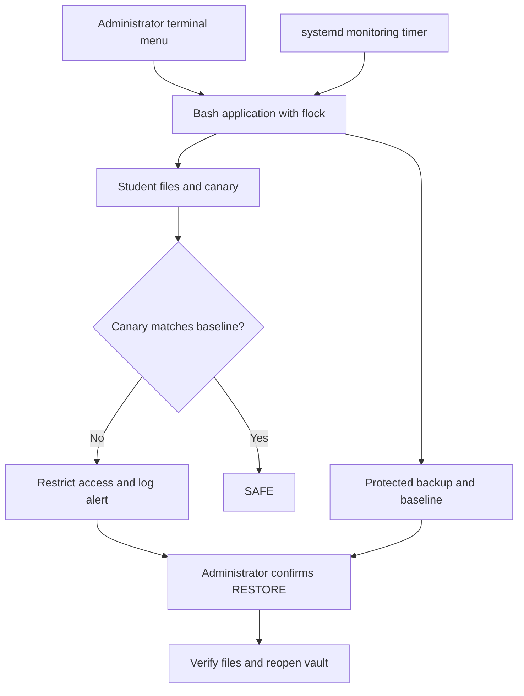

# Zero-Trust Linux Vault

### Protect access. Detect changes. Recover verified files.

**Bash · Ubuntu · Linux permissions · SHA-256 · systemd · Backup & recovery**

**Zero-Trust Enterprise Storage Vault with Automated Ransomware Defense and Disaster Rollback**

A Linux System Administration microproject implemented with **Bash shell scripting and Linux commands**. A terminal menu manages sample student files, access tests, a protected clean backup, periodic canary checks, incident logging, and administrator-confirmed recovery.

> Automatic detection and access restriction. Administrator-confirmed recovery.



[Project report](docs/Project_Report.pdf) · [Presentation](docs/Project_Presentation.pptx) · [Source code](src/ztvault.sh) · [Demo guide](docs/DEMO.md)

## Team and academic details

| Member | Registration number | Presentation section |
|---|---|---|
| Dharshini K | 2411021060912 | Introduction and system overview |
| Kani V | 2411021061023 | Access permissions and backup |
| Hemanath K | 2411021060862 | Monitoring and incident demonstration |
| Ibadul Azam | 2411021060840 | Recovery, validation and conclusion |

- **Institution:** Alliance School of Advanced Computing, Alliance University, Bengaluru
- **Course:** Linux System Administration (E1ITA307)
- **Supervisor:** Prof. Kusuma J
- **Academic year:** 2026–2027

## Submission files

- [Final project report](docs/Project_Report.pdf)
- [PowerPoint presentation](docs/Project_Presentation.pptx)
- [Four-person speaking script](docs/Four_Person_Speaking_Script.pdf)
- [Bash application source](src/ztvault.sh)
- [Ubuntu setup and operation guide](docs/SETUP.md)
- [Live demonstration guide](docs/DEMO.md)
- [Code explanation](docs/CODE_EXPLANATION.md)
- [Screenshot evidence index](screenshots/README.md)
- [GitHub upload guide](docs/GITHUB_UPLOAD.md)

## Problem and solution

A student must be able to update an assignment while outsiders cannot access it. The student must also be unable to modify the clean backup or trusted fingerprints. A canary file acts as a trap: normal assignment work should leave it unchanged.

The application checks this canary against a saved SHA-256 fingerprint. A failed check automatically restricts student access and records an alert. The administrator can verify and restore the original sample files through the menu.

## Main features

- Numbered terminal menu with input validation.
- Dedicated `ztv_writer` and `ztv_outsider` Linux accounts.
- Permission checks using `runuser` and `chmod`.
- One clean `tar` backup with SHA-256 verification.
- Periodic canary checks through a systemd timer.
- Automatic permission-based containment after a failed canary check.
- Timestamped application events and systemd service logs.
- Explicit `DEMO` and `RESTORE` confirmations.
- Shared `flock` lock to prevent overlapping operations.

## Requirements

The supplied evidence comes from **Ubuntu 26.04 on WSL2**, with **systemd** running as PID 1 and an **ext4** filesystem. Use Ubuntu with administrator access for the full demonstration.

Required utilities include Bash, `tar`, `sha256sum`, `flock`, `systemctl`, `journalctl`, `runuser`, and Linux account-management tools. The application has no Python backend, web server, or browser interface.

## Quick start

### Existing project on your laptop

If your vault already works, do not run the fresh-install script. Start it directly:

```bash
sudo ztvault
```

To export your actual installed source for submission, run this from the repository root:

```bash
sudo cat /usr/local/sbin/ztvault > src/ztvault.sh
bash -n src/ztvault.sh
```

Review and commit that exported source if you have made local changes since the report. The included application source corresponds to the report listing; screenshot sample wording may differ slightly from the supplied fresh-install samples.

### Fresh Ubuntu installation

Run these commands in **Ubuntu Bash**, not PowerShell. Git must be installed to clone the repository:

```bash
git clone https://github.com/dharshinik07/Linux-System-Administration.git
cd Linux-System-Administration
bash scripts/check.sh
sudo bash scripts/setup.sh
sudo ztvault
```

In the menu, choose **4** to create the clean backup and then **10** to enable automatic monitoring. The setup script deliberately refuses an existing project or colliding account/group names. It does not reset working files or trusted baselines.

## Menu options

| Choice | Operation |
|---|---|
| 1 | View assignment and marks |
| 2 | Add a sentence to the assignment |
| 3 | Test access permissions |
| 4 | Create or verify the clean backup |
| 5 | Check canary security now |
| 6 | Safely modify the sample canary after `DEMO` confirmation |
| 7 | Test student write blocking after an incident |
| 8 | Restore original files after `RESTORE` confirmation |
| 9 | View recent security events |
| 10 | Enable automatic monitoring |
| 0 | Exit the menu |

## Architecture



## Demonstrate the project in five minutes

| Step | Menu choice | What to show |
|---|---|---|
| 1 | **1**, then **3** | View the sample files and show successful student access and outsider denial. |
| 2 | **4** | Create the clean backup or verify the preserved archive. |
| 3 | **2**, then **1** and **5** | Add a sentence, show it was saved, and confirm the canary remains SAFE. |
| 4 | **10** | Enable automatic monitoring. |
| 5 | **6**, enter `DEMO` | Safely modify the sample canary. Return to the menu and wait about 15 seconds. |
| 6 | **7**, then **9** | Show that student writing is blocked and an alert was logged. |
| 7 | **8**, enter `RESTORE` | Verify and restore the original sample files. |
| 8 | **1**, then **5** | Show the original assignment and SAFE status. |
| 9 | Enter **99**; then choose **2** and submit blank input | Demonstrate invalid-choice and empty-input handling. |

Recovery returns the active files to the clean backup state; the demonstration sentence added afterward will disappear. The previous vault is preserved in the protected recovery directory.

## Linux paths and permissions

| Location | Purpose |
|---|---|
| `/usr/local/sbin/ztvault` | Installed Bash program |
| `/srv/ztvault/data` | `assignment.txt`, `marks.txt`, `canary.txt` |
| `/var/lib/ztvault/backups` | Clean archive and archive checksum |
| `/var/lib/ztvault/baselines` | Trusted sample-file and canary fingerprints |
| `/var/lib/ztvault/recovery` | Staged recovery and preserved previous vault |
| `/var/lib/ztvault/incident` | Incident state marker |
| `/var/log/ztvault/events.log` | Application event log |

The root-owned vault normally uses group `ztv_access` and mode `2770`. Sample files use `0660`. During containment, the directory changes to `0700`. Protected state is accessible only to root. The project uses the existing filesystem and does not configure LVM.

## Validation and evidence

The supplied screenshots document authorized reading, saved user input, outsider denial, protected backup access, existing archive verification, active timer scheduling, a safe canary simulation, automatic containment, manual recovery, and invalid-input rejection.

`bash scripts/check.sh` performs non-root checks in a temporary directory: Bash syntax, detection of changed canary contents through a checksum mismatch, and restoration of sample files with matching hashes. It does **not** exercise the complete application, account permissions, or a live systemd timer. Follow [DEMO.md](docs/DEMO.md) for those integration checks.

## Why these design choices matter

- **Separate canary file:** ordinary assignment edits remain possible without triggering an alert for every change.
- **Protected baseline:** the student account cannot rewrite the trusted fingerprints used for checks.
- **Preserved clean backup:** choosing backup again verifies the existing archive instead of silently replacing it with changed files.
- **Verified recovery:** archive and restored-file checks run before reopening student access.
- **Shared operation lock:** monitoring and menu operations avoid inspecting or modifying the same state simultaneously.

## Troubleshooting

| Message or symptom | What to do |
|---|---|
| Setup reports an existing project | Run `sudo ztvault` for the existing installation. Setup intentionally refuses to reset it. |
| Vault is already locked before a demonstration | Use option **8** with `RESTORE`, provided a valid clean backup exists. |
| Canary change has not triggered an automatic alert | Enable option **10**, return to the menu and allow a monitoring interval to pass. Option **5** checks immediately. |
| `Permission denied` during outsider or protected-backup tests | This is the expected result: check the accompanying PASS message. |
| systemd is not PID 1 | Use an Ubuntu environment with systemd running before installing this demonstration. |

For timer status and recent service output:

```bash
systemctl status ztvault-monitor.timer --no-pager
sudo journalctl -u ztvault-monitor.service -n 20 --no-pager
```

## Scope and limitations

This is an educational prototype demonstrating selected zero-trust principles. It is not a production enterprise platform or a general ransomware detector.

- Changes that leave the canary untouched may go undetected.
- Mode `0700` blocks new student path-based access, not root or already-open file handles.
- Monitoring runs only while Ubuntu is running and can skip a check while another operation holds the lock.
- Checks are periodic, approximately every ten seconds; detection is not instantaneous.
- The backup is local, manual and single-version, not offline or immutable.
- Recovery restores the original backup state, so subsequent legitimate edits disappear from the active files.
- The sample marks use the same shared permissions as the other example files; this is not a teacher-only marks system.
- The DEMO operation changes sample text only. It does not execute malware or encrypt data.

## Future scope

Off-device backups, multiple verified backup versions, broader integrity policies, stronger process containment, and administrator notifications.

## Source and evidence handling

The runtime application is Bash-only. This repository also includes documentation and presentation artifacts. Do not commit runtime backups, private documents, credentials, or unrelated logs. The provided screenshots use fictional student documents, but display the demonstration machine name, username and team registration details.
